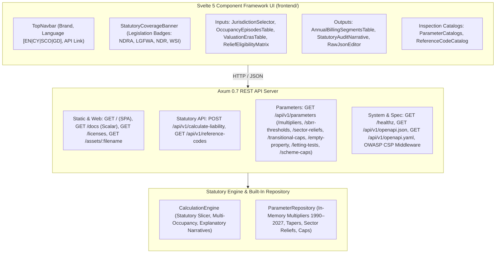

# Business Rates Calculation Engine — Specification, Test Cases & Source Index

> **Target Environment:** Full-Stack Rust Workspace & Svelte 5 Component Framework  
> **Backend Architecture:** Axum 0.7 + Tokio 1.38 + Built-In Parameter Repository (Seeded 1990–2027)  
> **Frontend Architecture:** Svelte 5 (Runes `$state`, `$derived`) + Vite 6 + TypeScript 5.7 + Standalone Tailwind CSS (`frontend/`)  
> **API Access Mode:** Public REST API  
> **API Documentation:** Interactive Scalar API Reference (`/docs`) & OpenAPI 3.1.0 (`/api/v1/openapi.json`)  
> **Internationalization (i18n):** Four-language support: English (`en`), Welsh (`cy`), Scots (`sco`), and Scottish Gaelic (`gd`) across UI, statutory narratives, relief names, error payloads, and reference codes  
> **Security Baseline:** OWASP-compliant HTTP security headers with strict Content Security Policy  
> **Coverage Period:** 1 April 1990 – 31 March 2027 (England, Wales, and Scotland)  

---

## 1. Statutory Source Index & Legislative References

The full authoritative statutory inventory of Acts of Parliament, Acts of the Scottish Parliament, Acts of the Senedd Cymru, Statutory Instruments (UK SIs), Scottish Statutory Instruments (SSIs), Welsh Statutory Instruments (WSIs), and VOA Rating Manuals governing all rating calculations, parameter tables, and audit trails across England, Wales, and Scotland (1990–2027) is maintained in:

👉 [**`STATUTORY_SOURCES.md`**](./STATUTORY_SOURCES.md)

*(See [`STATUTORY_SOURCES.md`](./STATUTORY_SOURCES.md) for primary rating acts, transitional phasing schemes, SBRR/SBBS tapers, multi-tier multipliers, unoccupied property exemptions, rural rate relief, and anti-avoidance legislation).*

---

## 2. Software Requirements Specification (SRS)

### 2.1 Architecture Overview

The system comprises three primary components:
- **Component UI (`frontend/`)**: A Svelte 5 Single-Page Application (SPA) compiled with Vite into static assets served by the backend at `/`.
- **API Documentation (`/docs`, `/api/v1/openapi.json`)**: Self-hosted Scalar API reference rendered via `templates/scalar.html` with query parameter templating and OpenAPI 3.1.0 specifications.
- **Calculation API (REST)**: Axum endpoints executing rating calculations, cataloging reference data, and serving parameter repository tables.



#### Key Technical Capabilities:
1. **Frontend Architecture**:
   - Built with Svelte 5 runes (`$state`, `$derived`) and TypeScript.
   - Compiled via `./build-frontend.sh` into `frontend/dist/`.
2. **Public REST API**:
   - Endpoints are accessible as a public service without requiring authentication tokens or API keys.
3. **Four-Language Internationalization (i18n)**:
   - Supports **English (`en`)**, **Welsh (`cy`)**, **Scots (`sco`)**, and **Scottish Gaelic (`gd`)**.
   - Language is negotiated dynamically: Request body `"language"` > Query parameter `?lang=` > `Accept-Language` header > Default `en`.
4. **Multi-Occupancy Section 44A Support**:
   - Supports multiple occupancy periods (`OCCUPIED`, `UNOCCUPIED`, `PART_OCCUPIED`) in a single calculation request.
   - Handles statutory occupation reset rules ($\ge 91$ days in England post-April 2024; $\ge 42$ days in Wales/Scotland) and Section 44A apportionments.
5. **OpenAPI 3.1.0 & Self-Hosted Scalar Reference**:
   - OpenAPI 3.1.0 specification stored in [`docs/openapi.yaml`](docs/openapi.yaml) and [`docs/openapi.json`](docs/openapi.json), served at `/api/v1/openapi.json` and `/api/v1/openapi.yaml`.
   - Interactive documentation served at `/docs` rendered via [`templates/scalar.html`](templates/scalar.html) using self-hosted `/assets/scalar.js`, supporting query parameter templating (`title`, `spec_url`, `theme`, `layout`).
6. **API Versioning & Routing**:
   - REST endpoints are organized under `/api/v1/` (`/calculate-liability`, `/reference-codes`, `/parameters/*`, `/openapi.*`).

---

### 2.2 OWASP Secure Headers Specification

All HTTP responses (HTML web pages, API JSON responses, static assets, and error handlers) are protected by centralized security middleware enforcing OWASP recommended headers:

| Header | Production Value | Purpose |
| :--- | :--- | :--- |
| `Content-Security-Policy` | `default-src 'self'; script-src 'self'; style-src 'self'; font-src 'self' data:; img-src 'self' data:; connect-src 'self'; frame-ancestors 'none'; form-action 'self'; base-uri 'self';` | Restricts script and style origins and prevents framing. |
| `X-Content-Type-Options` | `nosniff` | Prevents MIME-type sniffing. |
| `X-Frame-Options` | `DENY` | Eliminates clickjacking by disallowing framing. |
| `Strict-Transport-Security` | `max-age=31536000; includeSubDomains` | Enforces secure transport. |
| `Referrer-Policy` | `strict-origin-when-cross-origin` | Protects URI query data on navigation. |
| `Permissions-Policy` | `camera=(), microphone=(), geolocation=(), payment=()` | Restricts privileged browser hardware APIs. |
| `Cross-Origin-Opener-Policy` | `same-origin` | Isolates browsing contexts against Spectre attacks. |
| `Cross-Origin-Resource-Policy` | `same-origin` | Restricts cross-origin resource sharing. |
| `X-Permitted-Cross-Domain-Policies` | `none` | Blocks Flash/PDF policy leaks. |

> **Route-Scoped Style CSP Policy:** The `/docs` route allows `style-src 'self' 'unsafe-inline'` for Scalar theme styling, with `script-src 'self'`. All other routes enforce `style-src 'self'`.

---

### 2.3 Internationalization (i18n) & Language Resolution

The engine implements multilingual support via [`src/i18n.rs`](src/i18n.rs) and the frontend catalog store [`frontend/src/locales/`](frontend/src/locales/):

**Precedence Order for Language Resolution:**
1. Explicit request payload field: `"language": "cy"` / `"sco"` / `"gd"`
2. URL Query parameter: `?lang=cy`
3. HTTP Header: `Accept-Language: cy` / `sco` / `gd`
4. Default fallback: English (`en`)

**Localized Outputs:**
- **Statutory Audit Narrative**: Generated in English, Welsh, Scots, or Gaelic (e.g. Gaelic: *"AITHRIS REACHDAIL AIR ÀIREAMHACHADH ÌREAN & SLIGHE SGRÙDAIDH"*, Scots: *"STATUTARY CALCULATION NARRATIVE & AUDIT TRAIL"*, Welsh: *"DEDDF CYLLID LLYWODRAETH LEOL (CYMRU) 2024"*).
- **Itemized Relief Names**: Translated relief labels (e.g. Scots: *"Mandatar Chairitable Rate Relief"*, Gaelic: *"Faochadh Ìrean Carthannais Èigneachail"*, Welsh: *"Rhyddhad Elusennol Gorfodol"*).
- **Reference Codes**: Descriptions and labels localized on demand via repository queries.
- **API Error Messages**: Localized error payloads returning domain error codes and translated messages.

---

### 2.4 Core Calculation Engine Contract (`POST /api/v1/calculate-liability`)

#### Multi-Occupancy Request Payload Schema
```json
{
  "party_type": "INDIVIDUAL",
  "occupation_period": {
    "start_date": "2024-04-01",
    "end_date": "2025-03-31"
  },
  "hereditament": {
    "jurisdiction": "ENGLAND",
    "scat_code": "225",
    "rateable_value_history": [
      {
        "effective_from": "2023-04-01",
        "effective_to": null,
        "rateable_value": 12000.00
      }
    ]
  },
  "occupancy_periods": [
    {
      "start_date": "2024-04-01",
      "end_date": "2024-06-30",
      "occupancy_type": "UNOCCUPIED",
      "qualifying_relief_flags": {
        "days_previously_unoccupied": 0
      }
    },
    {
      "start_date": "2024-07-01",
      "end_date": "2024-12-31",
      "occupancy_type": "OCCUPIED",
      "qualifying_relief_flags": {
        "is_small_business_sole_property": true
      }
    },
    {
      "start_date": "2025-01-01",
      "end_date": "2025-03-31",
      "occupancy_type": "PART_OCCUPIED",
      "qualifying_relief_flags": {
        "is_small_business_sole_property": true
      },
      "part_occupied_apportionment": {
        "occupied_percentage": 50.0
      }
    }
  ],
  "language": "en"
}
```

#### Qualifying Relief Flags Specification (`QualifyingReliefFlags`)

All relief eligibility determinations are driven by strongly typed flags within `qualifying_relief_flags`:

| Field Name | Type | Jurisdiction & Statutory Scope | Description & Policy Rule |
| :--- | :--- | :--- | :--- |
| `is_small_business_sole_property` | `bool` | England, Wales, Scotland | Indicates ratepayer occupies only one non-domestic property in the jurisdiction. Triggers 100% SBRR/SBBS or linear taper. |
| `is_small_business_second_property` | `bool` | Wales | Ratepayer's second qualifying small business property in Wales under W.S.I. 2017/1229 art. 12 (max 2 properties per billing authority). |
| `is_small_business_grace_period` | `bool` | England | 12-month grace period on primary property when acquiring a secondary hereditament under S.I. 2017/411 art. 3(4). |
| `is_small_business_multiple_properties` | `bool` | Scotland | Ratepayer occupies multiple non-domestic properties in Scotland under SBBS reg. 4 multiple-property rules (S.S.I. 2023/34 / S.S.I. 2026/68). |
| `small_business_cumulative_rv` | `f64?` | Scotland | Cumulative rateable value across all occupied hereditaments in Scotland, subject to the £35,000 statutory cap under SBBS reg. 4. |
| `is_registered_childcare` | `bool` | Wales | Registered day childcare premises with CIW qualifying for 100% SBRR up to £100k RV under W.S.I. 2017/1229 art. 5. |
| `is_post_office` | `bool` | Wales | Post office premises qualifying for 100% SBRR up to £9k RV and 50% between £9,001 and £12k RV under W.S.I. 2017/1229 art. 4. |
| `is_charitable_purposes` | `bool` | All Jurisdictions | Mandatory 80% charitable relief under LGFA 1988 s.43(5) (England/Wales) or 1962 Act s.4(2) (Scotland). |
| `is_discretionary_charity_top_up`| `bool` | All Jurisdictions | Optional 20% local authority discretionary top-up under LGFA 1988 s.47(2)(a) / 1962 Act s.4(5). |
| `is_rhl_qualifying` | `bool` | England, Wales, Scotland | Qualifying premises under Retail, Hospitality and Leisure scheme criteria. |
| `is_retail_premises` | `bool` | Scotland, Wales | Qualifying retail shop (qualifies for Scottish 15% RHL or Welsh 35.0p Retail Multiplier under LGF(W)A 2024). |
| `is_hospitality_premises` | `bool` | Scotland | Qualifying hospitality (hotel, pub, restaurant, café, live music venue) under S.S.I. 2026/69 Sched 1A for 40% relief in Scotland. |
| `is_food_and_drink` | `bool` | Wales | Qualifying food & drink hospitality premises under Welsh 2026/27 15% rate relief scheme (LGFA 1988 s.47). |
| `is_higher_multiplier_excepted` | `bool` | Wales | High-value hereditament (>£100k RV) in Wales qualifying for statutory exception paying standard multiplier (0.502). |
| `is_scottish_island` | `bool` | Scotland | Hereditament on a Scottish island designated under Islands (Scotland) Act 2018 (qualifying for 100% island relief). |
| `is_scottish_remote_mainland` | `bool` | Scotland | Situated in Cape Wrath, Knoydart, or Scoraig qualifying for 100% relief under S.S.I. 2026/69 reg. 5. |
| `has_short_term_let_licence` | `bool?` | Scotland | Short-term let licence held under Civic Government (Scotland) Act 1982 / S.S.I. 2022/86; required for Scottish self-catering RHL and 15% transitional cap. |
| `holiday_let_days_let` | `i32?` | All Jurisdictions | Days commercially let in preceding 12 months (minimum 70 days in Scotland from 2022/23 under S.S.I. 2021/489; minimum 70 days in England from 2023/24 under S.I. 2022/217; minimum 70 days in Wales from 2010 under W.S.I. 2010/682 rising to 182 days from 2023/24 under W.S.I. 2022/563). |
| `holiday_let_days_available` | `i32?` | All Jurisdictions | Days commercially available to let in preceding 12 months (minimum 252 days in Wales post-2023 under W.S.I. 2022/563, 140 days elsewhere). |
| `is_rural_settlement` | `bool` | All Jurisdictions | Mandatory 100% rural settlement relief under LGFA 1988 s.43(6A) / S.S.I. 2009/64. |
| `is_public_lavatory` | `bool` | England, Wales | 100% exemption for standalone public conveniences under Rating (Public Lavatories) Act 2021. |
| `is_heat_network` | `bool` | England, Wales | 100% relief under NDRA 2023 s. 2 (effective 1 April 2024 – 31 March 2035; not enacted in Scotland). |
| `is_improvement_qualifying` | `bool` | England, Wales | 12-month G-factor improvement relief under NDRA 2023 s. 1 (effective 1 April 2024 – 31 March 2029; not enacted in Scotland). |
| `improvement_rateable_value_increase` | `f64?`| England, Wales | Rateable value attributable to qualifying improvements certified by the VOA under NDRA 2023 Schedule 1. |
| `is_telecommunications_infrastructure`| `bool` | England, Scotland | 100% relief under Telecommunications Infrastructure Act 2018 (England & Scotland only; excluded in Wales). |
| `is_renewable_energy_project` | `bool` | Scotland | Qualifying renewable electricity installation under S.S.I. 2010/336 tiered relief scheme. |
| `is_artificial_avoidance_suspected`| `bool`| Wales | Triggers Welsh civil financial penalty (£500 + 3% RV) under W.S.I. 2026/43; assessed once per calculation request. |
| `same_occupier_since_revaluation`| `bool?`| Wales | Hereditament occupied continuously by the same ratepayer since revaluation list date (required for Welsh TR under W.S.I. 2025/1371 reg. 6(b)). |
| `apply_transitional_relief` | `bool?` | All Jurisdictions | Opt-in/opt-out flag for statutory revaluation transitional phasing relief calculations. Defaults to true. |
| `is_ssbr_qualifying` | `bool` | England | Supporting Small Business Relief under LGFA 1988 s.47; caps net bill increase to £600/£800; compounds across years. |
| `is_sbbs_tr_qualifying` | `bool` | Scotland | Small Business Bonus Scheme Transitional Relief under S.S.I. 2023/31 / S.S.I. 2026/70 reg. 14. |
| `days_previously_unoccupied` | `i32` | All Jurisdictions | Number of unoccupied days elapsed prior to period start, deducted from initial empty rate-free period. |

> **Statutory Slicing, Validation & Execution Mechanics:**
> - **Billing Segment Slicing**: Calculation periods are partitioned into discrete billing segments when crossing:
>   1. **Financial Year Boundaries** (1 April – 31 March).
>   2. **Occupancy Transitions** (`OCCUPIED` ↔ `UNOCCUPIED` ↔ `PART_OCCUPIED`).
>   3. **Rateable Value Alteration Dates** (`rateable_value_history` effective date boundaries).
> - **Input Validation Rules**:
>   - Occupancy periods must not overlap (`AppError::OverlappingOccupancyPeriods`).
>   - Occupation period start date cannot precede the earliest rateable value effective date (`AppError::CalculationPeriodBeforeFirstRv`).
>   - Periods must have valid date ordering (`start_date <= end_date`).
> - **Section 43 (Occupied)**: Standard liability with SBRR, RHL, charitable relief, and G-factor improvement relief.
> - **Section 45 (Unoccupied)**: Initial 3-month (commercial) or 6-month (industrial) empty property rate-free exemption; low value exemption (£2,900 England, £2,200 Wales, £1,700 Scotland).
> - **Statutory Occupation Reset Rule**: Consecutive occupation of $\ge 13$ weeks (91 days) in England post-1 April 2024 (or $\ge 6$ weeks / 42 days in Wales/Scotland or pre-2024) resets empty rate-free entitlement.
> - **Section 44A (Part-Occupied)**: Apportions rateable value between occupied and unoccupied portions; unoccupied portion receives Section 45 empty relief; occupied portion receives occupied reliefs.
> - **Single Penalty Assessment**: Anti-avoidance financial penalties (W.S.I. 2026/43) are levied exactly once per calculation, regardless of how many segments are sliced.
> - **Annual Cash Cap Tracking**: Statutory cash caps (e.g. £110,000 RHL / Food & Drink Hospitality) are aggregated and enforced across all billing segments within the same financial year.

#### Response Payload Schema (`LiabilityCalculationResponse`)
```json
{
  "calculation_id": "8f7e2a91-4c3d-4e2a-9f12-0b3c4d5e6f7a",
  "calculated_at": "2026-10-11T09:30:42Z",
  "parameter_version_ids": {
    "param_multiplier_version": "v2026.1",
    "param_sbrr_version": "v2026.1",
    "param_sector_relief_version": "v2026.2"
  },
  "jurisdiction": "ENGLAND",
  "occupation_period": {
    "start_date": "2025-10-01",
    "end_date": "2026-09-30",
    "days": 365
  },
  "summary_financials": {
    "total_gross_liability": 7795.28,
    "total_transitional_adjustments": 197.01,
    "total_reliefs_and_discounts": 1998.08,
    "total_net_payable": 5600.19,
    "currency": "GBP"
  },
  "annual_billing_segments": [
    {
      "financial_year": "2025/26",
      "segment_period": { "start_date": "2025-10-01", "end_date": "2026-03-31", "days": 182 },
      "rateable_value": 14500.00,
      "multiplier_used": { "type": "SMALL_BUSINESS", "rate": 0.499 },
      "gross_liability": 3607.84,
      "transitional_adjustment": { "type": "NONE", "amount": 0.00 },
      "itemized_reliefs": [
        {
          "relief_code": "SBRR",
          "relief_name": "Small Business Rate Relief",
          "statutory_authority": "LGFA 1988 s.43(4B) / NDRA 2023",
          "discount_percentage": 16.67,
          "amount_deducted": 601.43
        }
      ],
      "net_segment_payable": 3006.41,
      "occupancy_type": "OCCUPIED"
    },
    {
      "financial_year": "2026/27",
      "segment_period": { "start_date": "2026-04-01", "end_date": "2026-09-30", "days": 183 },
      "rateable_value": 16000.00,
      "multiplier_used": { "type": "SMALL_BUSINESS", "rate": 0.522 },
      "gross_liability": 4187.44,
      "transitional_adjustment": { "type": "RELIEF", "amount": 197.01 },
      "itemized_reliefs": [],
      "net_segment_payable": 3990.43,
      "occupancy_type": "OCCUPIED"
    }
  ],
  "calculation_narrative": "STATUTORY CALCULATION NARRATIVE & AUDIT TRAIL\n=============================================\n1. Statutory Framework: Calculated under Local Government Finance Act 1988 (as amended by Non-Domestic Rating Act 2023) for England.\n2. Liability Period: 2025-10-01 to 2026-09-30 (Sliced into 2 billing segments).\n3.1 Financial Year 2025/26:\n    - Occupancy Status: Occupied (Full Occupation)\n    - Rateable Value: £14500\n    - Multiplier (SMALL_BUSINESS): 0.499\n    - Segment Duration: 182 days\n    - Gross Liability: £3607.84\n    - Relief [SBRR] Small Business Rate Relief (16.67%): -£601.43 [LGFA 1988 s.43(4B) / NDRA 2023]\n    - Net Segment Payable: £3006.41\n3.2 Financial Year 2026/27:\n    - Occupancy Status: Occupied (Full Occupation)\n    - Rateable Value: £16000\n    - Multiplier (SMALL_BUSINESS): 0.522\n    - Segment Duration: 183 days\n    - Gross Liability: £4187.44\n    - Transitional Adjustment [RELIEF]: -£197.01 [LGFA 1988 s.57A / NDR Chargeable Amounts Regs]\n    - Net Segment Payable: £3990.43\n=============================================\nTOTAL NET AMOUNT PAYABLE: £6996.84"
}
```

---

## 3. Built-In Statutory Parameter Repository (`src/db/repository.rs`)

The calculation engine uses an in-memory repository (`ParameterRepository` in `src/db/repository.rs`) pre-seeded with statutory parameters from 1990 to 2027 for England, Wales, and Scotland, requiring no external database service.

### 3.1 Repository Structure & Seeded Models

The built-in repository encapsulates 8 core statutory parameter domains:

```rust
pub struct ParameterRepository {
    multipliers: Vec<ParamMultiplier>,
    sbrr_sbbs_thresholds: Vec<ParamSbrrSbbsThreshold>,
    sector_reliefs: Vec<ParamSectorRelief>,
    transitional_caps: Vec<ParamTransitionalCap>,
    empty_property_thresholds: Vec<ParamEmptyPropertyThreshold>,
    letting_tests: Vec<ParamLettingTest>,
    scheme_caps: Vec<ParamSchemeCap>,
    reference_codes: Vec<ParamReferenceCode>,
}
```

#### Seeded Domain Models & Statutory Mapping

The repository seeds statutory values into 8 strongly-typed models (see [`STATUTORY_SOURCES.md`](./STATUTORY_SOURCES.md) for full statutory figures, caps, and legal citations):

| Model Struct | Primary Key / Index | Domain Coverage & Seeded Scope | Statutory Cross-Reference |
|---|---|---|---|
| `ParamMultiplier` | `(jurisdiction, financial_year, multiplier_type)` | 1990–2027 rating multipliers: England (5-tier 2026/27, Standard/Small), Wales (3-tier 2026/27, uniform), Scotland (3-tier property rates) | [`STATUTORY_SOURCES.md` §3.1](./STATUTORY_SOURCES.md#31-multipliers-by-nation--year) |
| `ParamSbrrSbbsThreshold` | `(jurisdiction, financial_year, tier)` | Small business relief tapers: England SBRR (£12k–£15k), Wales SBRR (£6k–£12k, Post Office, Childcare), Scotland SBBS (£12k–£15k–£20k) | [`STATUTORY_SOURCES.md` §3.2](./STATUTORY_SOURCES.md#32-small-business-schemes-sbrr-sbbs--ssbr) |
| `ParamSectorRelief` | `(jurisdiction, financial_year, relief_code)` | Sector schemes: RHL (England/Wales/Scotland), Food & Drink (Wales 2026/27), SSBR (£600/£800 caps), Improvement Relief (G-factor), Heat Network | [`STATUTORY_SOURCES.md` §4](./STATUTORY_SOURCES.md#4-sector-reliefs-exemptions-infrastructure--unoccupied-property) |
| `ParamTransitionalCap` | `(jurisdiction, reval_list, property_size, year)` | Revaluation transitional caps (1990–2026 lists): England upward caps, Wales 2-yr excess relief (> £300), Scotland General TR & SBBS TR | [`STATUTORY_SOURCES.md` §2](./STATUTORY_SOURCES.md#2-transitional-relief-tr-schemes--phasing-caps) |
| `ParamEmptyPropertyThreshold` | `(jurisdiction, financial_year)` | Low-value unoccupied exemption RV limits: England (£2,900 / £2,600 / £2,200), Wales (£2,200), Scotland (£1,700) | [`STATUTORY_SOURCES.md` §4](./STATUTORY_SOURCES.md#4-sector-reliefs-exemptions-infrastructure--unoccupied-property) |
| `ParamLettingTest` | `(jurisdiction, financial_year)` | Self-catering holiday accommodation letting days and commercial availability criteria across England, Wales, and Scotland | [`STATUTORY_SOURCES.md` §5](./STATUTORY_SOURCES.md#5-billing-appeals-holiday-lets--anti-avoidance) |
| `ParamSchemeCap` | `(jurisdiction, scheme_key)` | Scheme limits: Rural settlement caps (£8.5k/£12.5k), reset periods (91d / 42d), Welsh artificial avoidance penalties (£500 + 3% RV) | [`STATUTORY_SOURCES.md` §4, §5](./STATUTORY_SOURCES.md#4-sector-reliefs-exemptions-infrastructure--unoccupied-property) |
| `ParamReferenceCode` | `(category, code)` | Localized reference dictionaries (`en`, `cy`, `sco`, `gd`) for jurisdictions, statuses, SCAT codes, frequencies, and relief names | [§2.3](#23-internationalization-i18n--language-resolution) |

### 3.2 Lookup Methods

The repository exposes query methods:

```rust
impl ParameterRepository {
    pub fn resolve_multiplier(&self, jurisdiction: Jurisdiction, financial_year: &str, rv: Decimal) -> MultiplierInfo;
    pub fn calculate_sbrr_sbbs_discount(&self, jurisdiction: Jurisdiction, financial_year: &str, rv: Decimal) -> Decimal;
    pub fn get_sector_relief(&self, jurisdiction: Jurisdiction, financial_year: &str, relief_code: &str) -> Option<&ParamSectorRelief>;
    pub fn resolve_transitional_cap(&self, jurisdiction: Jurisdiction, financial_year: &str, rv: Decimal) -> Option<&ParamTransitionalCap>;
    pub fn resolve_empty_property_threshold(&self, jurisdiction: Jurisdiction, financial_year: &str) -> (Decimal, &'static str);
    pub fn resolve_holiday_let_thresholds(&self, jurisdiction: Jurisdiction, financial_year: &str) -> (u32, u32);
    pub fn resolve_rural_settlement_cap(&self, category: &str) -> Decimal;
    pub fn resolve_renewable_energy_relief_pct(&self, rv: Decimal) -> Decimal;
    pub fn resolve_occupancy_reset_days(&self, jurisdiction: Jurisdiction, financial_year: &str) -> i64;
    pub fn resolve_transitional_supplement(&self, jurisdiction: Jurisdiction, financial_year: &str, property_size: &str) -> Decimal;
    pub fn resolve_welsh_avoidance_penalty(&self) -> (Decimal, Decimal);
    pub fn get_reference_codes(&self, category: &str) -> Vec<&ParamReferenceCode>;
}
```

### 3.3 Statutory Parameter REST Endpoints & OpenAPI Documentation

The in-memory parameter repository and documentation are exposed via REST endpoints:
- `GET /api/v1/parameters`: Aggregated JSON payload containing all 8 parameter datasets (multipliers, SBRR/SBBS thresholds, sector reliefs, transitional caps, empty property thresholds, holiday let letting tests, devolved scheme caps, and reference codes).
- `GET /api/v1/parameters/multipliers`: Temporal rating multipliers array (1990–2027) disaggregated by jurisdiction.
- `GET /api/v1/parameters/sbrr-thresholds`: SBRR / SBBS rateable value thresholds and statutory linear relief rules.
- `GET /api/v1/parameters/sector-reliefs`: Devolved retail, hospitality, leisure, and special relief schemes.
- `GET /api/v1/parameters/transitional-caps`: Statutory revaluation transitional phasing percentage caps.
- `GET /api/v1/parameters/empty-property`: Low-value empty property rateable value exemption thresholds across all lists (1990–2027) for England, Wales, and Scotland.
- `GET /api/v1/parameters/letting-tests`: Statutory holiday let actual let and commercial availability days thresholds.
- `GET /api/v1/parameters/scheme-caps`: Scheme-specific financial limits, statutory additions, reset days, and penalty schedules.
- `GET /api/v1/openapi.json` & `GET /api/v1/openapi.yaml`: OpenAPI 3.1.0 specifications documenting models, calculation endpoints, schemas, and parameter filters.
- `GET /docs`: Scalar API reference UI rendered from `templates/scalar.html` with query parameter templating (`?title=...&spec_url=...&theme=...&layout=...`).

---

## 4. Test Cases Specification & Scenario Fixtures

### Test Suite Overview (136 Passing Integration Tests)

The test suite is organized under [`tests/integration_tests/`](tests/integration_tests/) across 10 modular suites (Suites A through J) plus shared helpers in [`tests/integration_tests/common.rs`](tests/integration_tests/common.rs), coordinated by [`tests/integration_tests.rs`](tests/integration_tests.rs). All tests run against authoritative statutory assertions:

| Suite | Module / File | Tests | Statutory Coverage Domain & Key Validations |
|---|---|---|---|
| **Suite A** | [`tests/integration_tests/suite_a_scenarios.rs`](tests/integration_tests/suite_a_scenarios.rs) | 11 | Multi-jurisdiction scenario fixtures (Scenarios 1–11): SBRR/RHL multi-year slicing, SCAT 211 forecourt, G-factor certificates, 10/12 instalments, rural settlement, 80% mandatory charity relief. |
| **Suite B** | [`tests/integration_tests/suite_b_multi_occupancy.rs`](tests/integration_tests/suite_b_multi_occupancy.rs) | 7 | Temporal billing slicing: mid-year RV alterations, continuous multi-occupancy arrays, overlapping period rejection, open-ended occupation default (2027-03-31), out-of-order prior empty days. |
| **Suite C** | [`tests/integration_tests/suite_c_i18n.rs`](tests/integration_tests/suite_c_i18n.rs) | 10 | 4-nation statutory language parity (`en`, `cy`, `sco`, `gd`): audit narratives, localized relief titles, reference code resolution, localized 422/400 error payloads, header/body content negotiation. |
| **Suite D** | [`tests/integration_tests/suite_d_api_and_parameters.rs`](tests/integration_tests/suite_d_api_and_parameters.rs) | 13 | REST API & parameters: `GET /api/v1/parameters`, `/health`, `/ready`, OpenAPI schema contract synchronization (`docs/openapi.{json,yaml}`), Scalar API docs `/docs`. |
| **Suite E** | [`tests/integration_tests/suite_e_england_schemes.rs`](tests/integration_tests/suite_e_england_schemes.rs) | 20 | England rating schemes: 2026/27 5-multiplier regime (S.I. 2026/152), 2026 TR upward caps (+5%/+15%/+30%), London £28k / outside £20k boundary, SBRR linear taper ($E$ divisor), SSBR £600/£800 caps. |
| **Suite F** | [`tests/integration_tests/suite_f_wales_schemes.rs`](tests/integration_tests/suite_f_wales_schemes.rs) | 27 | Wales rating schemes: 2026/27 3 multipliers (Retail 0.350, Standard 0.502, Higher 0.515), 2-year TR (67%/34% over £300 excess), 2026/27 Food & Drink 15% relief, artificial avoidance penalties (W.S.I. 2026/43). |
| **Suite G** | [`tests/integration_tests/suite_g_scotland_schemes.rs`](tests/integration_tests/suite_g_scotland_schemes.rs) | 16 | Scotland rating schemes: 3 property rates (Basic 0.481, Intermediate 0.535, Higher 0.548), SBBS dual tapers (£12k–£15k–£20k) & multiple properties rules, 2026 RHL (15% mainland, 40% hospitality, 100% islands). |
| **Suite H** | [`tests/integration_tests/suite_h_cross_jurisdictional.rs`](tests/integration_tests/suite_h_cross_jurisdictional.rs) | 18 | Cross-jurisdictional reliefs & lifespans: Heat Network (2024–2035), Improvement Relief (2024–2029), holiday lets actual letting tests (Scotland 70d, England 70d, Wales 70d pre-2023 / 182d post-2023), empty property. |
| **Suite I** | [`tests/integration_tests/suite_i_ui_and_security.rs`](tests/integration_tests/suite_i_ui_and_security.rs) | 7 | Svelte 5 single-page application delivery: static asset serving, OWASP secure HTTP headers, strict Content Security Policy, ETag caching & 304 responses, Greater London UI toggle (`flag_is_greater_london`). |
| **Suite J** | [`tests/integration_tests/suite_j_historical.rs`](tests/integration_tests/suite_j_historical.rs) | 7 | Historical rating revaluations (1990–2022): 1990 inaugural NNDR, historical transitional phasing (1991, 1993, 1995, 2000, 2017), SBRR evolution (pre-2005 0%, 2005 list 50%, 2010 list 100% doubled taper). |

---

## 5. Execution & Verification Guide

To build, verify, and run the project:

```bash
# 1. Build the Svelte 5 frontend with Vite
./build-frontend.sh

# 2. Run the integration test suite (136 tests)
cargo test --test integration_tests

# 3. Start the HTTP server (default port 8080)
cargo run --bin business_rates_engine

# 4. Execute a calculation via curl (Public REST API)
curl -s -X POST http://localhost:8080/api/v1/calculate-liability \
  -H "Content-Type: application/json" \
  -d @tests/fixtures/scenario_1_sbrr_rhl_england.json

# 5. Execute with language content negotiation (e.g. Welsh, Scots, or Scottish Gaelic)
curl -s -X POST http://localhost:8080/api/v1/calculate-liability \
  -H "Content-Type: application/json" \
  -H "Accept-Language: cy" \
  -d @tests/fixtures/scenario_1_sbrr_rhl_england.json

# 6. Retrieve statutory parameters
curl -s http://localhost:8080/api/v1/parameters

# 7. Access the web UI in your browser
open http://localhost:8080/

# 8. Access the Scalar API reference in your browser
open http://localhost:8080/docs

# 9. Access third-party software licenses in your browser
open http://localhost:8080/licenses
```
